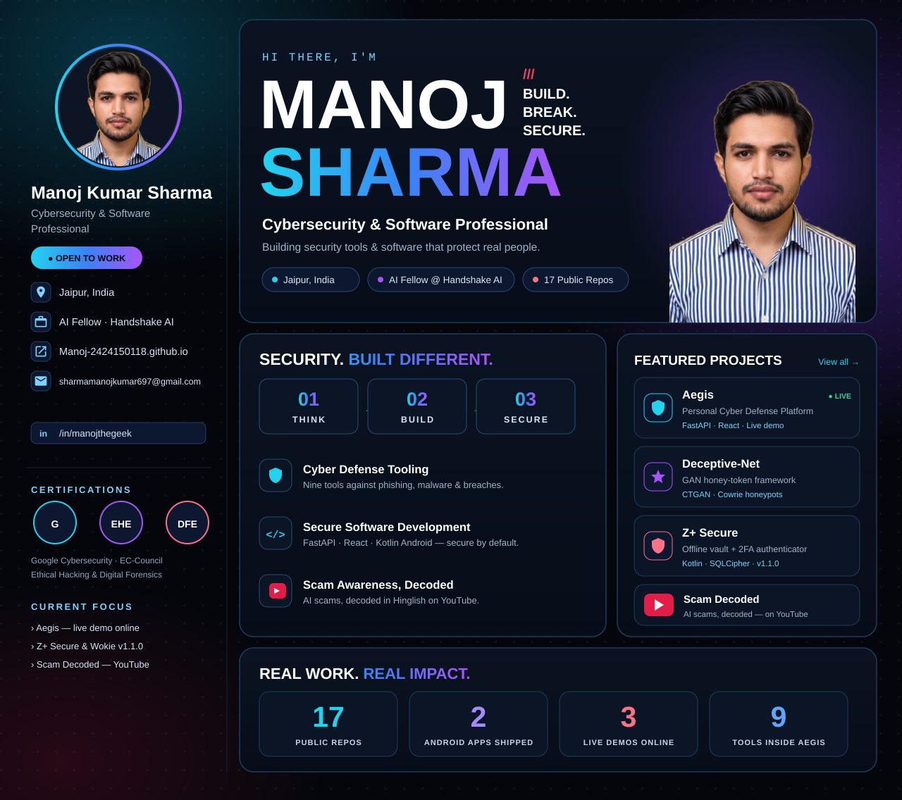

<div align="center">




</div>

<br/>

## Who I Am

```typescript
const manoj = {
  title: "Cybersecurity & Software Professional",
  education: "MCA, Manipal University Jaipur (2026)",
  currentRole: "AI Fellow at Handshake AI",
  stack: [
    "Python", "Java", "Kotlin", "TypeScript", "HTML", "CSS",
    "JavaScript", "SQL", "PHP", "AWS Cloud",
    "Anthropic Claude", "Google Gemini", "Google NotebookLM",
    "Burp Suite", "Metasploit", "Nmap", "Google Dorking", "Shodan"
  ],
  launchedProjects: [
    "Aegis — Personal Cyber Defense Platform",
    "Deceptive-Net: A Honey-Token Generative Framework",
    "SIEM: Automated Threat Hunting & Incident Response Pipeline",
    "Z+ Secure — Encrypted Vault & Authenticator (Android)",
    "Wokie — Offline Encrypted Mesh Messaging (Android)",
    "SecurePasswordGenerator"
  ],
  certifications: [
    "Google Cybersecurity Professional Certificate (V1 & V2)",
    "EC-Council Digital Forensics Essentials",
    "EC-Council Ethical Hacking Essentials"
  ],
  research: "Secure Password Generator / KMAC DRBG — paper presented at ICDSA 2026 (under review)",
  status: "MCA graduate — building deception & detection tooling, one recon scan at a time",
  openTo: ["SOC Analyst", "Security Analyst", "Software Developer"]
};
```

<br/>

## 📌 Featured Projects

<div align="center">

<a href="https://github.com/Manoj-2424150118/aegis-cyber-defense-platform">
  
</a>
<a href="https://github.com/Manoj-2424150118/Deceptive-Net-A-Honey-Token-Generative-Framework">
  
</a>

<a href="https://github.com/Manoj-2424150118/SIEM">
  
</a>
<a href="https://github.com/Manoj-2424150118/Z-Security">
  
</a>

<a href="https://github.com/Manoj-2424150118/Wokie">
  
</a>
<a href="https://github.com/Manoj-2424150118/SecurePasswordGenerator">
  
</a>

</div>

### 🛡️ Flagship — Aegis: Personal Cyber Defense Platform

A production-grade FastAPI + React application that protects an individual user against today's most common cyber threats — phishing links, phishing/BEC email, malware attachments, weak and breached passwords, stolen secrets, and unsafe websites — across nine tools: a phishing URL analyser, a phishing/BEC email analyser, an in-memory malware file scanner, a Password Lab with Have-I-Been-Pwned k-anonymity breach checks, an AES-256-GCM encrypted vault (Argon2id key derivation), a website security audit, plus a scam-message checker, a domain-security checker, and a TLS-certificate inspector. Every finding ships with a concrete suggested fix, and every analysis streams live to the browser stage-by-stage.

| Layer | Technology |
|---|---|
| Backend | FastAPI (Python) · Argon2id · JWT |
| Frontend | React · TypeScript |
| Security | AES-256-GCM vault · k-anonymity breach checks · OWASP hardening |
| Quality | 123 pytest tests · CI · CodeQL · Docker |

🔗 Code: [github.com/Manoj-2424150118/aegis-cyber-defense-platform](https://github.com/Manoj-2424150118/aegis-cyber-defense-platform) · 🚀 **Live demo: [aegis-cyber-defense-platform.onrender.com](https://aegis-cyber-defense-platform.onrender.com)** *(free-tier hosting — the first load after idle can take ~1 minute while the service wakes up)*

More shipped work: **Deceptive-Net** — GAN-generated honey-tokens deployed into Cowrie honeypots for early intrusion detection · **SIEM** — Elastic-based detection pipeline that verifies attacker IPs against VirusTotal, blocks them at the firewall, and alerts on Telegram/Slack/Discord · **Z+ Secure** (Android, v1.1.0) — fully offline encrypted password vault + 2FA authenticator, SQLCipher + PBKDF2, no Internet permission · **Wokie** (Android, v1.1.0) — offline end-to-end-encrypted mesh messaging over nearby radios, no server, no account.

<br/>

## 📊 GitHub Stats

<div align="center">


</div>

<br/>

## Tech Stack

**Languages**


**Security Tools**


**Cloud & DevOps**


**Frameworks & Libraries**


<br/>

## Certifications & Education

- 🎓 **MCA** — Manipal University Jaipur (2026)
- 🎓 **BCA, Cloud Technology & Information Security** — Vivekananda Global University, Jaipur
- 🛡️ **Google Cybersecurity Professional Certificate**
- 🛡️ **EC-Council** — Ethical Hacking Essentials · Digital Forensics Essentials
- 📄 **Research:** Secure Password Generator / KMAC DRBG — paper presented at **ICDSA 2026** *(under review)*

<br/>

## 🎬 Scam Decoded — My YouTube Channel

I run **Scam Decoded**, a faceless Hinglish channel exposing AI voice-clone family scams, digital-arrest fraud and the tricks scammers use on Indian families — so viewers can recognise them before money moves.

<div align="center">

<a href="https://www.youtube.com/@ScamDecodedIndia">
  
</a>

</div>

<br/>

## Connect With Me

<div align="center">

<a href="https://www.linkedin.com/in/manojthegeek">
  
</a>
<a href="https://www.youtube.com/@ScamDecodedIndia">
  
</a>
<a href="mailto:sharmamanojkumar697@gmail.com">
  
</a>
<a href="https://Manoj-2424150118.github.io">
  
</a>

</div>

<br/>


