  

  

  

  
  
  

## Featured Projects

  
  

  
  

  
  

---

## About

MCA graduate from Manipal University Jaipur (2024–2026, CGPA 7.60) with a BCA in Cloud Technology & Information Security from Vivekananda Global University. I build secure software and defensive tooling — from a live multi-tool cyber defense platform to generative honey-token deception systems — and my research sits in applied cryptography, where my paper on a KMAC-based deterministic random bit generator was presented at ICDSA 2026 and is currently under review. Currently an AI Fellow at Handshake AI; previously a Cyber Security Intern at Plasmid Innovation. Based in Jaipur, India, and open to cybersecurity and software roles across India.

---

## Technical Skills

**Backend Development**

**Cryptographic Standards**

**Offensive / Defensive Security Tooling**

**DevOps & Infrastructure**

---

## Current Focus & Research

- **Threat deception architectures** — extending **Deceptive-Net**, my capstone: a WGAN-GP framework that generates honey tokens, now with planted canary credentials (AWS keys, GitHub PATs, API keys, database DSNs) tracked through a SHA-256 fingerprint-only registry, so a leaked decoy identifies its source without ever storing the raw secret.
- **Applied cryptography** — the Secure Password Generator / KMAC-based DRBG work: deterministic random bit generation built on KMAC, presented at **ICDSA 2026** and currently **under review**.
- **Aegis Cyber Defense Platform** — a live personal cyber defense platform with 9 working security tools (link, email and message analysis, file scanning, password lab, encrypted vault, website audit and more), running on Render.

## Certifications

---

## Contact

📧 [sharmamanojkumar697@gmail.com](mailto:sharmamanojkumar697@gmail.com) · 💼 [LinkedIn — ManojTheGeek](https://www.linkedin.com/in/ManojTheGeek) · 📍 Jaipur, India

  
  

The cards at the top of this profile are animated SVGs drawn from my real contribution data by <a href="./scripts/render_readme_cards.py">scripts/render_readme_cards.py</a>, refreshed daily by GitHub Actions.
